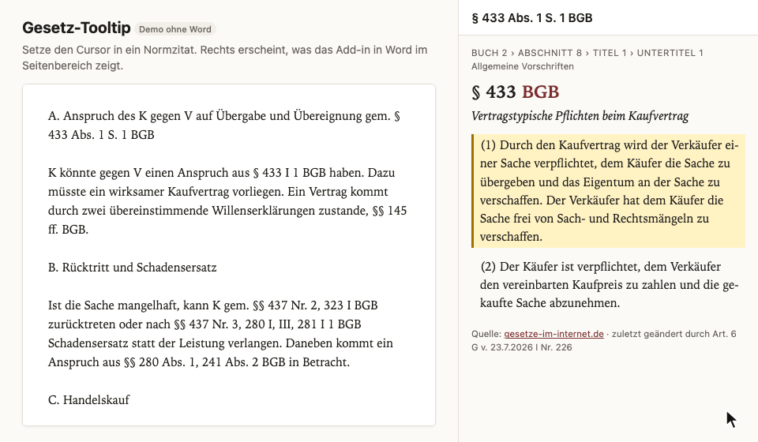
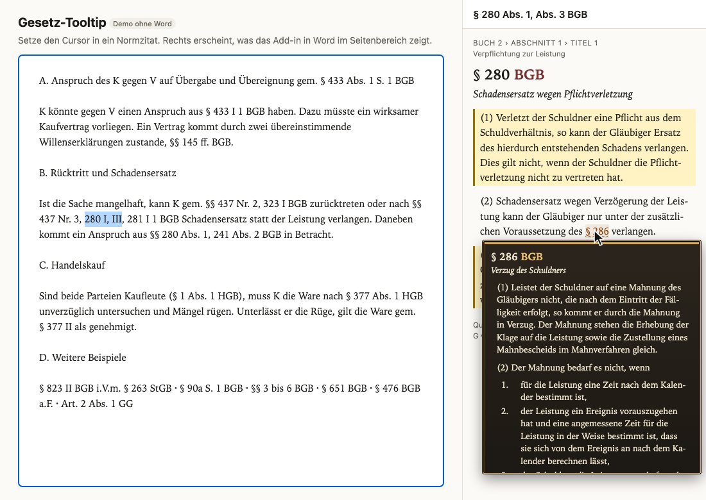
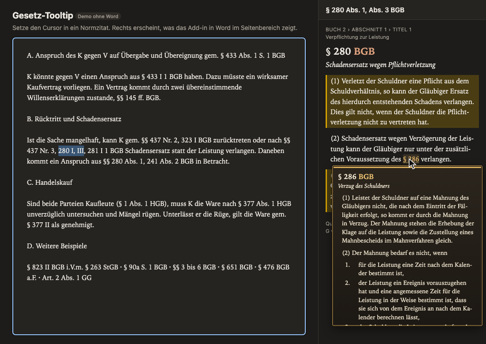
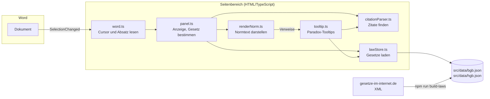

# Gesetz-Tooltip

Ein Word-Add-in für das deutsche Recht: Steht der Cursor in einem Normzitat wie „§ 433 Abs. 1 BGB“ oder „§§ 280 I, III, 281 I 1 BGB“, zeigt ein Seitenbereich den Normtext, die zitierten Absätze, Sätze und Nummern sind hervorgehoben. Verweise im Normtext funktionieren wie die Tooltips in Paradox-Spielen (Crusader Kings 3, Victoria 3): kurz darauf zeigen, der Tooltip erscheint, setzt sich fest, und Verweise darin öffnen den nächsten.

**[Live-Demo im Browser](https://gradklon.github.io/word-gesetz-tooltip/)** (ohne Word; ein Textfeld spielt das Dokument)



Enthalten sind **BGB und HGB** im aktuellen Stand von gesetze-im-internet.de. Das ist ein Portfolio-Projekt, kein fertiges Produkt.

## Funktionen

- **Zitate erkennen:** Paragrafen und Artikel mit Absatz, Unterabsatz, Satz, Halbsatz, Nummer, Buchstabe und Alternative, auch in römischer Kurzform (`§ 433 I 1`), Ketten (`§§ 437 Nr. 3, 280 I, III, 281 BGB`), Bereiche (`§§ 3 bis 6`), `f.`/`ff.`, `a.F.`, `i.V.m.` und ausgeschriebene Gesetzesnamen.
- **Gesetz ohne Angabe:** Fehlt das Gesetz, nimmt das Add-in das zuletzt im Absatz genannte oder das, in dem es die Norm gibt; ein Knopf schaltet um.
- **Tooltips:** 400 ms Verzögerung, dann füllt sich ein Balken; nach 1 s ist der Tooltip festgesetzt und lässt sich betreten. Tooltips stapeln sich beliebig tief. Verlässt die Maus einen Tooltip, schließen er und alle darüber. Klick oder Enter öffnet sofort, Escape schließt.
- **Kompakt:** Bei „§ 280 Abs. 1“ zeigt der Tooltip nur Abs. 1, der Rest lässt sich aufklappen.
- **Andere Gesetze:** Verweise auf StGB, ZPO, GG usw. werden erkannt; der Tooltip verlinkt auf gesetze-im-internet.de.
- **Offline:** Die Gesetzestexte liegen als JSON bei, es gibt keinen Server und kein Backend.

| Hell | Dunkel |
| --- | --- |
|  |  |

## Warum ein Seitenbereich und kein Hover im Dokument?

Die ursprüngliche Idee war, direkt im Word-Dokument über ein Zitat zu fahren. Office-Add-ins (Office.js) bekommen aber **keine Mausereignisse aus dem Dokument**, nur Ereignisse wie „Auswahl geändert“. Die Alternativen hatten jeweils einen Haken:

| Variante | Hover im Dokument | Plattformen | Problem |
| --- | --- | --- | --- |
| Word-ScreenTips an Hyperlinks | ja, aber nur Text | Windows, Mac | Kein Format, keine Verschachtelung, verändert das Dokument |
| VSTO-Add-in (C#) | ja | nur Windows | Läuft nicht auf dem Mac, hoher Aufwand |
| **Seitenbereich (gewählt)** | nein, Cursor statt Maus | Windows, Mac, Web | Der Hover beginnt erst im Seitenbereich |

Gewählt wurde der Seitenbereich: Der Cursor im Dokument wählt die Norm, die Paradox-Tooltips leben im Seitenbereich, wo das Add-in volle Kontrolle über HTML und Maus hat.

## Aufbau



| Datei | Aufgabe |
| --- | --- |
| [`scripts/build-laws.mts`](scripts/build-laws.mts) | Lädt die XML-Fassung von BGB und HGB, wandelt sie in JSON (Absätze, Aufzählungen, Gliederung, Fußnoten) |
| [`scripts/verify-laws.mts`](scripts/verify-laws.mts) | Gleicht jede Norm mit der HTML-Seite auf gesetze-im-internet.de ab (zuletzt 3.246 Seiten, 0 Abweichungen) |
| [`src/citationParser.ts`](src/citationParser.ts) | Findet Zitate per Tokenizer aus „sticky“ regulären Ausdrücken, liefert Norm, Stellen und Gesetz |
| [`src/lawStore.ts`](src/lawStore.ts) | Lädt die Gesetzesdateien bei Bedarf und sucht Normen |
| [`src/renderNorm.ts`](src/renderNorm.ts) | Baut das HTML der Norm und hebt die zitierten Stellen hervor |
| [`src/tooltip.ts`](src/tooltip.ts) | Macht Verweise hoverbar; Verzögerung, Festsetzen, Stapel, Position in der schmalen Pane |
| [`src/taskpane/`](src/taskpane/) | Seitenbereich, Word-Anbindung und Browser-Demo |

Kein Framework: TypeScript mit DOM-Funktionen, gebaut mit webpack aus der Vorlage von `yo office`.

## Ausprobieren

### Im Browser

Die [Live-Demo](https://gradklon.github.io/word-gesetz-tooltip/) läuft ohne Word. Lokal:

```bash
npm install
npm run dev-server
```

Danach `https://localhost:3000/` öffnen.

### In Word (Entwicklung)

Voraussetzungen: Node.js 22.15 oder neuer (entwickelt mit 24), Word für Mac oder Windows.

```bash
npm install
npx office-addin-dev-certs install
npm start
```

`npm start` startet den Dev-Server, meldet das Add-in in Word an und öffnet ein Dokument mit dem Seitenbereich. In anderen Dokumenten: **Start › Gesetze › Normen anzeigen**. Zum Ausprobieren eignet sich [`beispiele/Testgutachten.docx`](beispiele/Testgutachten.docx). Beenden mit `npm stop`.

### In Word (über GitHub Pages)

Ohne lokalen Server lässt sich die veröffentlichte Fassung laden: [`manifest.xml`](https://gradklon.github.io/word-gesetz-tooltip/manifest.xml) herunterladen und

- **Mac:** nach `~/Library/Containers/com.microsoft.Word/Data/Documents/wef/` kopieren, Word neu starten,
- **Word im Web:** im Add-in-Dialog unter „Meine Add-ins“ › „Mein Add-In hochladen“.

## Entwicklung

| Befehl | Zweck |
| --- | --- |
| `npm test` | Tests (vitest, DOM-Tests mit happy-dom) |
| `npm run typecheck` | TypeScript prüfen |
| `npm run lint` | ESLint und Prettier |
| `npm run build` | Produktions-Build nach `dist/` |
| `npm run build-laws` | Gesetzesdaten neu von gesetze-im-internet.de erzeugen |
| `npm run verify-laws -- --all` | Alle Normen gegen die Webseite prüfen (ca. 20 Minuten) |

287 Tests, davon 185 mit Zitierweisen aus der Praxis (Gutachten, Kommentare, Urteile). Bei jedem Push auf `main` testet, baut und veröffentlicht [ein Workflow](.github/workflows/pages.yml) die Seite auf GitHub Pages.

## Grenzen

- **Nur BGB und HGB.** Weitere Gesetze bräuchten nur einen Eintrag in `build-laws` und `lawStore`, machen das Add-in aber größer.
- **Heuristischer Parser.** Manche Zitate erschließen sich nur aus dem Satz, etwa „folgende Vorschriften des Handelsgesetzbuchs:“ vor einer Liste (§ 707b BGB) oder „dieses Gesetzes“, das in § 340 HGB das Kreditwesengesetz meint. Solche Fälle sind in den Tests dokumentiert.
- **Aktuelle Fassung.** Bei „a.F.“ zeigt das Add-in einen Hinweis, aber den heutigen Text.
- **Schmale Pane.** Verschachtelte Tooltips verdecken den darunterliegenden oft fast ganz.

## Quelle und Lizenz

Die Gesetzestexte stammen von [gesetze-im-internet.de](https://www.gesetze-im-internet.de/) (Bundesministerium der Justiz) und sind als amtliche Werke gemeinfrei (§ 5 UrhG). Redaktionelle Fußnoten der Dokumentation („+++ … +++“) sind nicht übernommen. Der Code steht unter der [MIT-Lizenz](LICENSE).
